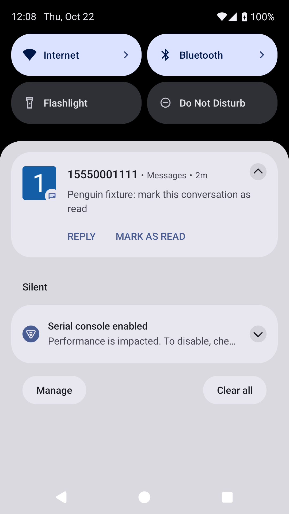
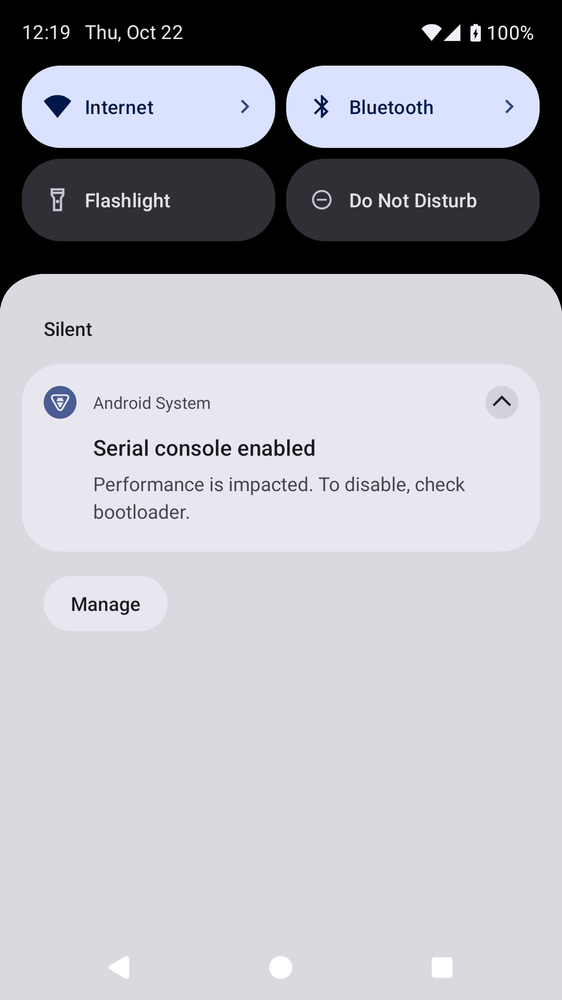
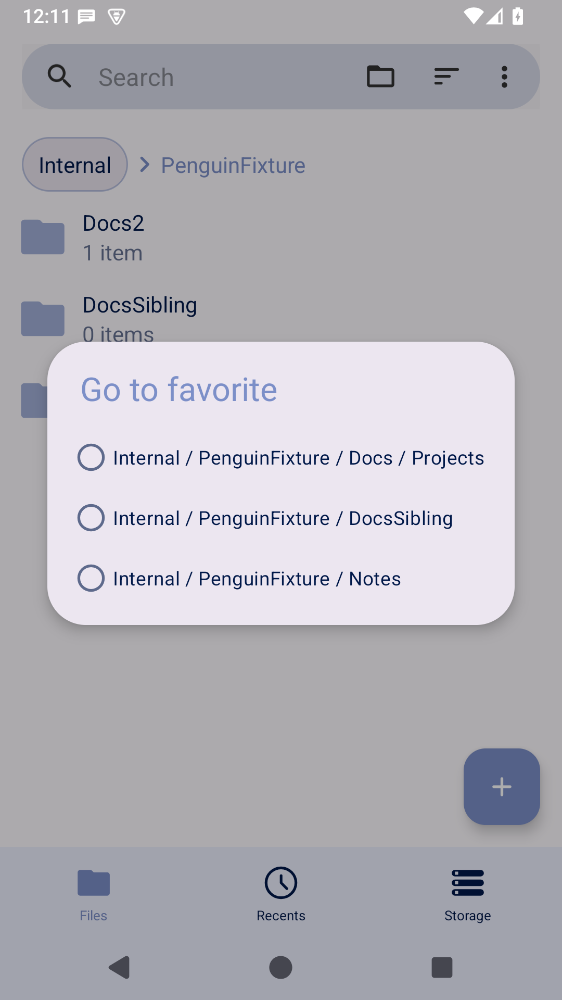
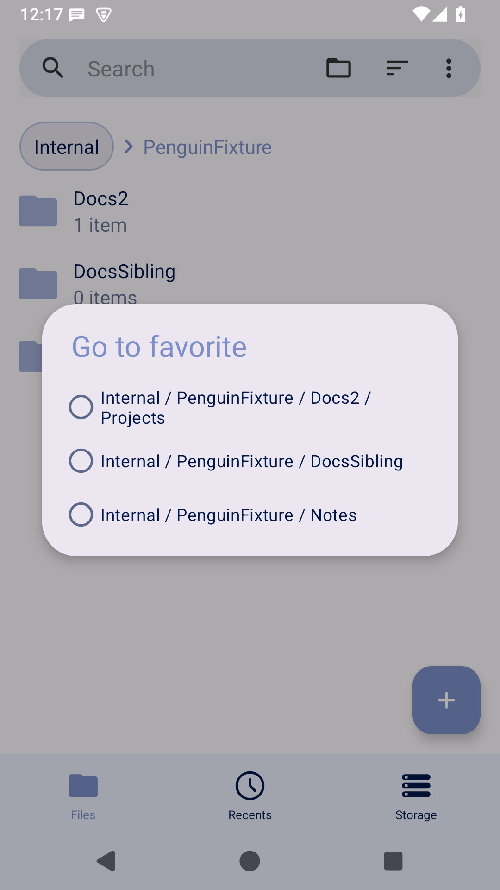

# Penguin Patches verification screenshots — 2026-10-22

Native 1080 × 1920 Android 15 ARM64 emulator captures, synthetic data only. No resized or generated app screenshots. Before uses official Fossify release APK; after uses the same release APK patched by Penguin Patches. Same emulator, font, theme and viewport per pair.

## Messages 1.10.1 — issue #929

Before: conversation has been marked read through the conversation-list menu, but its notification is still present. After: the same menu operation removes the notification. The final after run marks both synthetic conversations read; it contains no Messages notification. No force-stop or notification-clear step occurs between the final menu action and screenshot. An earlier integration check plus instrumentation confirmed an unrelated unread thread notification remains.

| Before | After |
| --- | --- |
|  |  |

## File Manager 1.6.2 — issue #513

Both captures follow a real UI rename Docs → Docs2. Before: the favorite remains Docs/Projects; after: it follows Docs2/Projects. DocsSibling and Notes are unaffected.

| Before | After |
| --- | --- |
|  |  |

A real multi-select rename dialog also updated both direct favorites (multiple-after.png). Native instrumentation: 6 notification assertions; 26 path/callback/original-rename assertions. Additional real UI deletion checks remove only the deleted subtree favorites. Full details and scope: pengusto/penguin-patches dev docs/MESSAGES.md and docs/FILE_MANAGER.md.

Original APK provenance: official Fossify GitHub releases. Messages SHA-256 af81e85e0e5442cf22d9669f43ecc42e39737389cff8fe91fd0ef58dab59703d; File Manager SHA-256 c2993c75ea7287e7ede354b061d9c8772aa9b4b050e7660ec1ebc3592dc3d051.

Limits: physical OEM phones/launcher badges, real carrier SMS/MMS, external SAF/SD/root backends and on-device Morphe Manager remain unverified. Test-signing key and APKs are disposable, not installation deliverables. Screenshots/results retained as public verification evidence; no personal messages/accounts/files were used.
