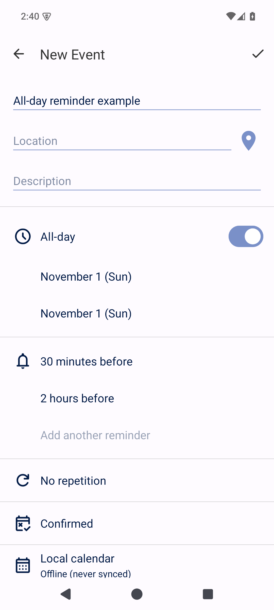
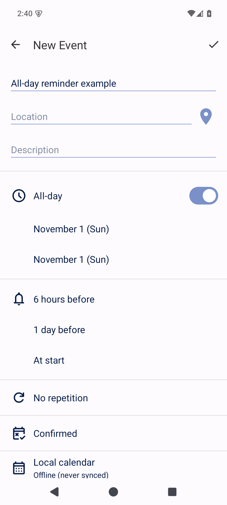

# Calendar #381: separate all-day reminders, original / Morphe comparison

Captured on 2026-10-24 on a disposable rooted AOSP Android 15 / API 35 ARM64 emulator. All data is synthetic and local. The PNGs are raw native Android screenshots, without image editing.

## Inputs and publication scope

- [Official Calendar 1.12.0 release](https://github.com/FossifyOrg/Calendar/releases/tag/1.12.0), asset `calendar-23-foss-release.apk`, package `org.fossify.calendar`, version code 23.
- Original APK SHA-256: `d43b2df05d5702bea760a7ab03402977ba72e446e5932038efbdab248a5de987`.
- Official certificate SHA-256: `affdb124d3f4720c2f98dbca9eacba0514fba4306e20a2786c861c3c0d6ff292`.
- Before: unchanged official APK code/resources, re-signed with a disposable test key.
- After: the official original APK with the local **Separate all-day reminder defaults** Morphe patch and the existing **Readable Calendar descriptions** patch, signed with the same disposable test key. This demonstrates same-key test updates; it does not demonstrate updating an upstream-signed installation with a different certificate.
- These images show the Morphe-patched official APK, not a native source fix. Only evidence is published here. The new patch code/bundle, APKs, keys, databases, preferences and full logs remain unpublished. The current public Penguin Patches release does not contain this reminder patch. No native PR has been opened.

## Matched comparison

Both screenshots open an unsaved new all-day draft with the same synthetic title and dates. The native reuse-last-reminders setting is disabled. Timed defaults are 30 minutes / 2 hours / disabled in both variants. The separate all-day values are 6 hours / 1 day / at start; the original app ignores those additional preferences.

| Before: all-day draft inherits timed defaults | After: all-day draft uses separate defaults |
| --- | --- |
|  |  |

[Settings](settings.png) show the separate all-day rows. [A timed draft](timed.png) retains 30 minutes / 2 hours, with no third reminder. Other presets include 12 hours, and custom whole minutes are supported. All-day values use Calendar's existing minutes-before-local-midnight semantics.

The evidence runner verifies the original APK checksum/certificate, unchanged baseline payload, patched acceptance identity and matching test certificate. It compares every stored database row and preference before/after each APK update and after navigating these unsaved drafts/settings. No event is saved or deleted during screenshot capture, and the final data/preferences match the initial fixture. The patched test APK is restored afterwards.

[verification.json](verification.json) contains the APK/certificate and screenshot hashes and the matched-capture results. The separate local acceptance suite passed 131 integration checks for the reminder patch alone, 131 with both Calendar patches, 92 UI/process-restoration checks, 4 negative-input cases, and build/lint. Those results cover more than the screenshots themselves.

## Limits and attribution

Only Calendar 1.12.0 on this Android 15 AOSP emulator was tested. Physical/OEM devices, battery-restricted delivery, real CalDAV/Outlook sync, imported cloud events, task defaults, native settings export of the new preferences and other app versions remain unverified. Screenshots do not prove notification delivery or synchronization.

Calendar and its native UI are by Fossify and contributors, GPL-3.0. Penguin Patches is an independent GPL-3.0 Morphe-compatible collection. This evidence addresses [Calendar #381](https://github.com/FossifyOrg/Calendar/issues/381); a native PR is subject to maintainer greenlight.
