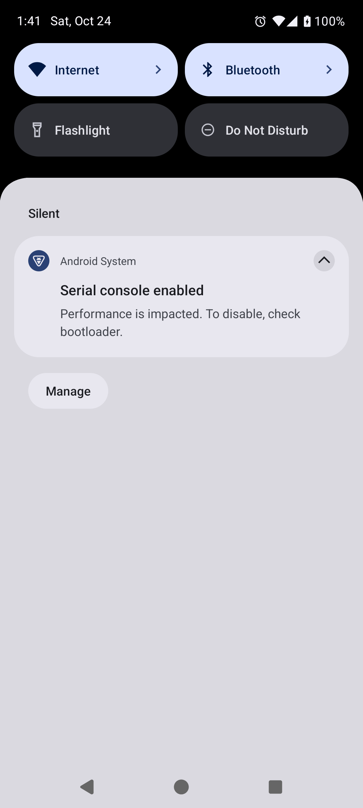
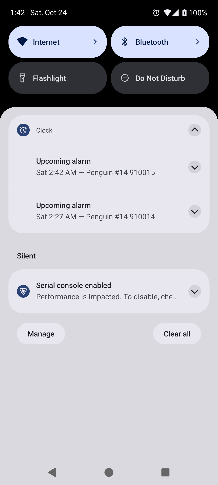

# Clock #14: original / Morphe prototype comparison

Captured on 2026-10-24 on a disposable rooted AOSP Android 15 / API 35 ARM64 emulator. Only synthetic alarm data is shown. These are raw native screenshots, without image editing.

## Inputs and scope

- Original: [official Clock 1.6.0 APK](https://github.com/FossifyOrg/Clock/releases/download/1.6.0/clock-10-foss-release.apk), package `org.fossify.clock`, version code 10.
- Official APK SHA-256: `43cf9f0ec45f1f1ff2df47286622e5b8f3acedaeb07b7f7641b5243dbedca079`.
- The baseline has unchanged official code/resources, re-signed with a disposable test key. The patched build uses the same test key, allowing an in-place update and data-retention checks. This does not demonstrate updating an official installation with a different key.
- The after images show the Morphe-patched official APK, **not a native source implementation**. The local prototype uses `leadMinutes=120`, configured at patch time; it does not add an in-app setting.
- [Penguin Patches](https://github.com/pengusto/penguin-patches) hosts the existing patch collection. The Clock prototype code/bundle and APKs are **not published**. These files publish evidence only.

## Matched comparison

Two enabled daily synthetic alarms, IDs 910014 (A) and 910015 (B), are scheduled approximately 45 and 60 minutes ahead. Both variants use exactly the same alarm definitions and ringing timestamps.

| Original 1.6.0: no upcoming notice outside its ten-minute window | Morphe prototype: both notices inside the chosen 120-minute window |
| --- | --- |
|  |  |

The runner uses Clock's real scheduling API and observes natural AlarmManager delivery. No warning receiver is called directly and no notification object is injected. The screenshot runner expands Clock's notification group through its native control so the two alarms can be inspected.

- [Original alarm list](alarms-original.png) and [patched alarm list](alarms-patched.png) show the same enabled fixture alarms.
- [After invoking A's actual notification action](after-dismiss-A.png), only B's notice remains. The daily alarm definitions remain unchanged; only A's current occurrence is skipped.
- [verification.json](verification.json) records the observed notification IDs/timestamps, APK and screenshot checksums, same-key update retention and fixture cleanup results. Unrelated database rows remain unchanged.

## Limits

This comparison proves the configured window and distinct notices on this emulator. A separate local original-APK identity probe reproduced shared upcoming PendingIntents; that collision is not inferred from the before screenshot alone. The broader local suite separately checks overlapping/equal-time alarms, stale actions, native ringing/snooze, disable/delete, restart/rescheduling and data retention.

Physical/OEM devices, audible output, deep Doze/battery restrictions and full device reboot remain unverified. Raw logs, databases, APKs and signing keys are not included. A future native implementation needs its own tests; maintainer approval is being requested in [Clock #14](https://github.com/FossifyOrg/Clock/issues/14#issuecomment-6376790938).
