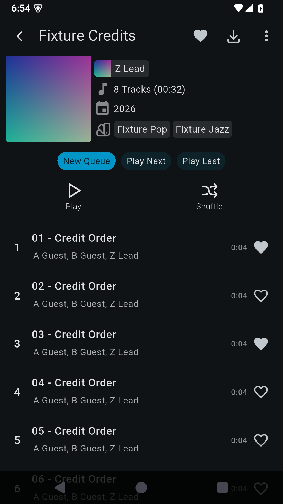
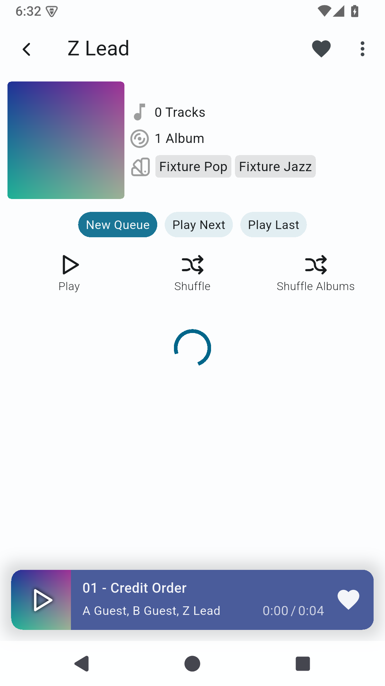

# Before & after

See what each patch changes. Choose a patch below or follow **Before / after** from the [README catalogue](../README.md#generated-patch-catalogue). Click any image for its original size.

All images reuse published, unedited evidence with synthetic data. Each pair names its actual baseline: Android APKs, source widgets, or a previous patch implementation. These examples illustrate the visible change; exact APK versions, installation instructions and verification limits stay in the linked guides.

| App | Patch / visible change |
| --- | --- |
| Finamp 1.0.1 | [Song artist order](#song-artist-order) |
| Finamp 1.0.1 | [Fix section title validation](#fix-section-title-validation) |
| Finamp 1.0.1 | [Load artist pages faster](#load-artist-pages-faster) |
| Feeder 2.25.0 · project GitHub F-Droid APK | [Zoom article images](#zoom-article-images) |
| Infinity+ 8.3.4 | [Configure custom OAuth for Infinity+](#configure-custom-oauth-for-infinity) |
| Fossify Calendar 1.12.0 | [Readable Calendar descriptions](#readable-calendar-descriptions) |
| Fossify Calendar 1.12.0 | [Separate all-day reminder defaults](#separate-all-day-reminder-defaults) |
| Fossify Messages 1.10.1 | [Dismiss notifications when marking conversations read](#dismiss-notifications-when-marking-conversations-read) |
| Fossify Messages 1.10.1 | [Keep background conversations unread](#keep-background-conversations-unread) |
| Fossify Messages 1.10.1 | [Avoid notifications for visible conversations](#avoid-notifications-for-visible-conversations) |
| Fossify File Manager 1.6.2 | [Keep favorites consistent after folder rename or removal](#keep-favorites-consistent-after-folder-rename-or-removal) |
| Fossify Contacts 1.6.0 | [Show emails and notes from merged contacts](#show-emails-and-notes-from-merged-contacts) |
| Fossify Music Player 1.8.4 | [Prefer each track's embedded cover](#prefer-each-track-s-embedded-cover) |
| Kvaesitso 1.41.0 | [Restore widget editing from the search menu](#restore-widget-editing-from-the-search-menu) |
| Fossify Clock 1.6.0 | [Choose upcoming alarm notification time](#choose-upcoming-alarm-notification-time) |
| Tasks.org 15.13 · project GitHub F-Droid APK | [Navigate to the parent task](#navigate-to-the-parent-task) |

## Song artist order

**Finamp 1.0.1** · [Setup & patch details](FINAMP_NATIVE.md)

Put the album artist first, then alphabetize the other song credits. Choose alternative modes in settings without rewriting music metadata.

**Android APK captures.** Same synthetic album and Dark theme. The before APK retains the official native code; the after APK has the native patch.

| Before | After |
| :---: | :---: |
| **A Guest, B Guest, Z Lead** | **Z Lead, A Guest, B Guest** |
|  |  |

[Capture provenance & checks](../tests/finamp/evidence/2026-10-28/README.md) · [Back to patch index](#before--after)

## Fix section title validation

**Finamp 1.0.1** · [Setup & patch details](FINAMP_NATIVE.md)

Typing a valid custom home-section title updates validation and enables Save immediately.

**Source-widget comparison, not Android APK screenshots.** These are actual Finamp widgets rendered by Flutter tests, upstream redesign versus the combined source fixes. The native APK fix is verified separately in the [APK record](../tests/finamp/evidence/2026-10-28/README.md); its original before-image is obscured by the keyboard.

| Before | After |
| :---: | :---: |
| **Playlists entered; error remains and Save is disabled** | **Playlists entered; error clears and Save is enabled** |
|  |  |

[Capture provenance & checks](https://github.com/pengusto/finamp/tree/7e168434482e4e1e7b77a0c37337edb28291e2f8/contribution-evidence/2026-10-28) · [Back to patch index](#before--after)

## Load artist pages faster

**Finamp 1.0.1** · [Setup & patch details](FINAMP_NATIVE.md)

Show the artist preview and track count without waiting for the full discography response.

**Android APK captures.** The fixture deliberately holds unbounded requests. Light before and Dark after are fixture settings, not a theme feature. This demonstrates query behavior, not a measured real-server speedup.

| Before | After |
| :---: | :---: |
| **Pending full-song queries: spinner and 0 Tracks** | **Bounded queries: preview and 8 Tracks appear** |
|  |  |

[Capture provenance & checks](../tests/finamp/evidence/2026-10-28/README.md) · [Back to patch index](#before--after)

## Zoom article images

**Feeder 2.25.0 · project GitHub F-Droid APK** · [Setup & patch details](FEEDER.md)

Open an article image in its own viewer and pinch, pan or double-tap to inspect small details.

**Android APK captures.** Same synthetic offline article and image; the after capture shows actual zoom in the separate Morphe-patched viewer.

| Before | After |
| :---: | :---: |
| **Diagram stays at article width** | **Same diagram enlarged in the image viewer** |
|  |  |

[Capture provenance & checks](https://github.com/pengusto/penguin-patches/tree/8177428db162ed2e1a1b8de245cce479969046d3/feeder-391/2026-10-24) · [Back to patch index](#before--after)

## Configure custom OAuth for Infinity+

**Infinity+ 8.3.4** · [Setup & patch details](INFINITY.md)

Use your own authorized Reddit OAuth client and reach the existing login flow without the app subscription prompt.

**Breal versus Penguin comparison.** Both are patched Infinity+ APKs; the Breal before capture uses the recorded billing state 4, not the unmodified official app. The after image shows login consent, with no account data. Reddit API approval/access is still required.

| Before | After |
| :---: | :---: |
| **Breal 1.4.123: Subscription prompt blocks login** | **Penguin: login reaches the User Agreement** |
|  |  |

[Capture provenance & checks](https://github.com/pengusto/penguin-patches/tree/8177428db162ed2e1a1b8de245cce479969046d3/infinity-834/2026-10-25) · [Back to patch index](#before--after)

## Readable Calendar descriptions

**Fossify Calendar 1.12.0** · [Setup & patch details](CALENDAR.md)

Read an HTML event description as text while retaining an explicit Edit HTML source action.

**Previous versus revised Morphe patch.** This is the wrapperless-table regression on the official APK, not an original-versus-patched pair or a source-fork capture. It demonstrates readable cell text, not a full HTML table layout. Live Outlook sync is outside the evidence.

| Before | After |
| :---: | :---: |
| **Previous Morphe patch: raw table tags** | **Revised patch: Morning Workshop, with source editing** |
|  |  |

[Capture provenance & checks](https://github.com/pengusto/penguin-patches/tree/8177428db162ed2e1a1b8de245cce479969046d3/calendar-table-review) · [Back to patch index](#before--after)

## Separate all-day reminder defaults

**Fossify Calendar 1.12.0** · [Setup & patch details](CALENDAR_REMINDERS.md)

Give new all-day events their own reminder defaults while keeping timed-event defaults separate.

**Android APK captures.** Same unsaved draft, dates and timed defaults. The after prototype includes both Calendar patches; the pictured difference is the all-day reminder defaults. These are configured example values, not the first-run defaults.

| Before | After |
| :---: | :---: |
| **All-day draft inherits 30 minutes / 2 hours** | **Same draft uses 6 hours / 1 day / at start** |
|  |  |

[Capture provenance & checks](https://github.com/pengusto/penguin-patches/tree/8177428db162ed2e1a1b8de245cce479969046d3/calendar-381/2026-10-24) · [Back to patch index](#before--after)

## Dismiss notifications when marking conversations read

**Fossify Messages 1.10.1** · [Setup & patch details](MESSAGES.md)

Remove a conversation notification after marking that conversation read from the app list.

**Android APK captures.** Synthetic SMS only. The final after run marks both fixture threads read; unrelated-thread retention is established by the separate tests, not this empty shade alone.

| Before | After |
| :---: | :---: |
| **Marked read in the list; notification remains** | **Marked read in the list; Messages notification removed** |
|  |  |

[Capture provenance & checks](https://github.com/pengusto/penguin-patches/tree/8177428db162ed2e1a1b8de245cce479969046d3/README.md) · [Back to patch index](#before--after)

## Keep background conversations unread

**Fossify Messages 1.10.1** · [Setup & patch details](MESSAGES.md)

Keep an incoming message unread when its conversation is open in a background Activity.

**Android APK captures.** The fixture leaves the thread with Home, receives a synthetic SMS, then opens the conversation list. Provider records confirm read=1 before and read=0 after. Lifecycle patches are tested together and apply independently.

| Before | After |
| :---: | :---: |
| **Background message appears read; no unread count** | **Background message stays bold with unread count 1** |
|  |  |

[Capture provenance & checks](https://github.com/pengusto/penguin-patches/tree/8177428db162ed2e1a1b8de245cce479969046d3/messages-lifecycle) · [Back to patch index](#before--after)

## Avoid notifications for visible conversations

**Fossify Messages 1.10.1** · [Setup & patch details](MESSAGES.md)

Avoid leaving a notification for a message already received in the currently visible conversation.

**Android APK captures.** Same visible-thread scenario with synthetic SMS, followed by Back and the notification shade. No manual notification dismissal occurs between receipt and capture.

| Before | After |
| :---: | :---: |
| **Read while visible; notification remains after Back** | **Read while visible; no Messages notification after Back** |
|  |  |

[Capture provenance & checks](https://github.com/pengusto/penguin-patches/tree/8177428db162ed2e1a1b8de245cce479969046d3/messages-lifecycle) · [Back to patch index](#before--after)

## Keep favorites consistent after folder rename or removal

**Fossify File Manager 1.6.2** · [Setup & patch details](FILE_MANAGER.md)

Keep nested favorites pointing to the right folder after a parent-folder rename.

**Android APK captures.** Both follow a real Docs → Docs2 UI rename with synthetic files. This pair illustrates rename handling; selected-deletion cleanup and its pre-deletion timing are documented in the guide.

| Before | After |
| :---: | :---: |
| **Docs renamed to Docs2; favorite still uses Docs/Projects** | **Favorite follows Docs2/Projects** |
|  |  |

[Capture provenance & checks](https://github.com/pengusto/penguin-patches/tree/8177428db162ed2e1a1b8de245cce479969046d3/README.md) · [Back to patch index](#before--after)

## Show emails and notes from merged contacts

**Fossify Contacts 1.6.0** · [Setup & patch details](CONTACTS.md)

See the email and note contributed by a duplicate contact in the merged detail view.

**Android APK captures.** The same synthetic contact pair is shown with Merge duplicate contacts enabled. Source contact records are retained; this is a display fix.

| Before | After |
| :---: | :---: |
| **Merged view hides the duplicate email and note** | **Email and Local note stays intact are visible** |
|  |  |

[Capture provenance & checks](https://github.com/pengusto/penguin-patches/tree/8177428db162ed2e1a1b8de245cce479969046d3/contact-music) · [Back to patch index](#before--after)

## Prefer each track's embedded cover

**Fossify Music Player 1.8.4** · [Setup & patch details](MUSIC.md)

Show the artwork embedded in the current track rather than reusing another track's album cover.

**Android APK captures.** Two synthetic audio files share an album ID and have different embedded covers. File hashes and the existing fallback path are checked separately.

| Before | After |
| :---: | :---: |
| **Penguin Blue and Penguin Red both show red artwork** | **Penguin Blue shows blue; Penguin Red stays red** |
|  |  |

[Capture provenance & checks](https://github.com/pengusto/penguin-patches/tree/8177428db162ed2e1a1b8de245cce479969046d3/contact-music) · [Back to patch index](#before--after)

## Restore widget editing from the search menu

**Kvaesitso 1.41.0** · [Setup & patch details](KVAESITSO.md)

Reach the existing widget editor from the search-bar menu even when the on-screen Edit button is hidden.

**Android APK captures.** Same hidden-button preference and synthetic widget layout. The patched action opens the app's existing editor; it does not re-enable the hidden button.

| Before | After |
| :---: | :---: |
| **Search menu has no Edit widgets action** | **Edit widgets appears at the top of the same menu** |
|  |  |

[Capture provenance & checks](https://github.com/pengusto/penguin-patches/tree/8177428db162ed2e1a1b8de245cce479969046d3/kvaesitso-1504/2026-10-24) · [Back to patch index](#before--after)

## Choose upcoming alarm notification time

**Fossify Clock 1.6.0** · [Setup & patch details](CLOCK.md)

Choose when upcoming-alarm notices appear and keep a separate notice for each alarm.

**Android APK captures.** Same two alarms, approximately 45 and 60 minutes ahead. The notices arrive through natural AlarmManager delivery. Lead time is configured in Morphe when patching; this adds no in-app setting.

| Before | After |
| :---: | :---: |
| **No upcoming notices outside the original ten-minute window** | **Two alarm notices within the configured 120-minute window** |
|  |  |

[Capture provenance & checks](https://github.com/pengusto/penguin-patches/tree/8177428db162ed2e1a1b8de245cce479969046d3/clock-14/2026-10-24) · [Back to patch index](#before--after)

## Navigate to the parent task

**Tasks.org 15.13 · project GitHub F-Droid APK** · [Setup & patch details](TASKS.md)

Open the immediate parent task from the child editor using an explicit up-arrow.

**Android APK captures.** Same synthetic child task, notes and date. The guide also records Save / Discard / Cancel for changed drafts. The red reminder warning is existing Android permission state, not a change made by this patch.

| Before | After |
| :---: | :---: |
| **Child editor has no parent-navigation action** | **Up-arrow appears next to the existing actions** |
|  |  |

[Capture provenance & checks](https://github.com/pengusto/penguin-patches/tree/8177428db162ed2e1a1b8de245cce479969046d3/tasks-2838/2026-10-24) · [Back to patch index](#before--after)

## About these comparisons

Some evidence was published while a patch was still a prototype. Its pinned provenance keeps that historical wording; the [current release catalogue](../README.md#generated-patch-catalogue) records what is published now. APK captures and source-widget captures establish different things. Screenshots alone do not establish physical-device, account-sync, carrier or real-library performance acceptance. See each guide for the tested scope.

Upstream apps and their UI retain their respective authorship and license terms. [License and visual provenance](PROVENANCE.md) · [Safe setup and signing](SETUP.md).
