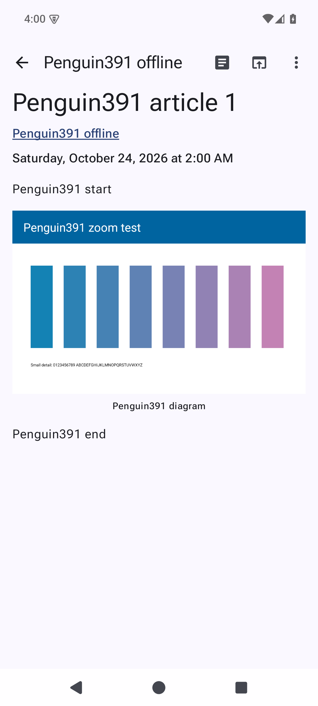
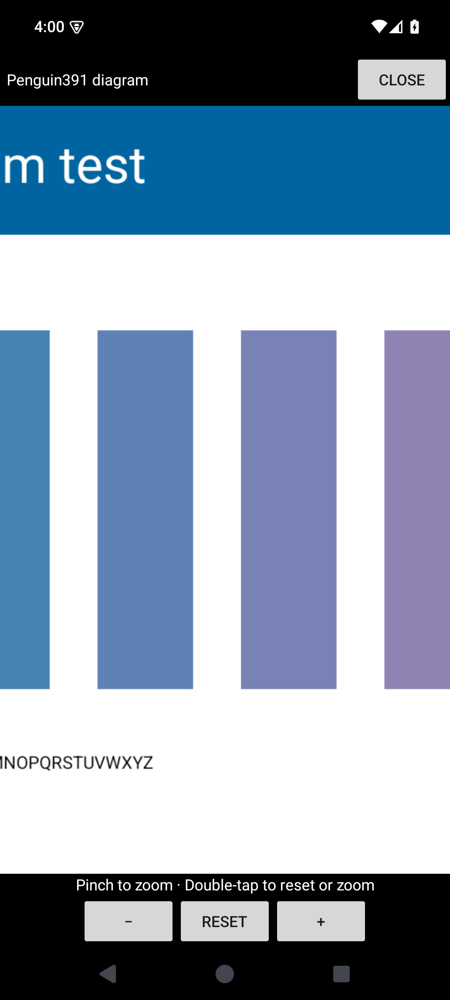

# Feeder #391: separate image viewer prototype

Captured on 2026-10-24 on a disposable rooted AOSP Android 15 / API 35 ARM64 emulator. The article, linked image and diagram are synthetic fixtures. The four PNGs are raw native emulator captures, without image editing.

## Inputs and publication scope

- Official [Feeder 2.25.0 project release](https://github.com/spacecowboy/Feeder/releases/tag/2.25.0), asset `app-fdroid-release.apk`, package `com.nononsenseapps.feeder`, version code 4191. This is the project's GitHub F-Droid flavor; independently built F-Droid.org and Play APKs are untested.
- Original APK SHA-256: `3e03c3f9fd3ac6131eea56e513b129c71df11dadfccb836221480f9204f50766`.
- Official signer SHA-256: `c5eeff22488135ffc2583c3a43b053a161ca869862961ab8534f44c75fd57d97`.
- Before: unchanged official APK code/resources, re-signed with an existing disposable test key.
- After: the same official original APK with the local **Zoom article images** Morphe patch, signed with the same disposable test key.
- These images demonstrate the local Morphe-patched APK. A native source PR for Feeder's current Compose reader would be a separate implementation, subject to maintainer greenlight.
- Only reviewed images and these curated evidence documents are published here. The Feeder patch code/bundle, APKs, signing keys, databases, preferences and full logs remain unpublished. The current public Penguin Patches release does not contain this Feeder patch.

## Matched comparison

The same synthetic article `Penguin391 article 1` and diagram are used in the original and patched variants. Tapping the original image leaves it at article width. The local patch opens it in a separate viewer: pinch to zoom, drag to pan, double-tap for 3x/reset, plus zoom/reset buttons. Zoom is bounded between fit and 8x.

| Before: original APK payload after tapping the image | After: local Morphe patch, zoomed |
| --- | --- |
|  |  |

[Viewer at fit size](after.png) shows the initial viewer state. [Linked-image menu](link-menu.png) shows **View image / Open link** on the synthetic second article; Open link follows the original Feeder callback. Both article-body images and the large reader header image are covered. Feed-list thumbnails retain their native behavior.

The viewer reuses Feeder's existing application ImageLoader, cache, metered-network policy and 2500-pixel decode limit. Loading errors offer retry; closing/stopping the Activity cancels the native image job and rejects late callbacks. Recreation returns to the reader rather than restoring the temporary viewer/zoom state. No new runtime library or separate network client is added.

## Verification and limits

The original reproduces the missing viewer/zoom behavior (10 baseline assertions). The patched APK passes 284 native integration assertions, including real multi-pointer pinch/pan/double-tap events, header/body/table images, PNG/JPEG/static GIF/WebP, declared srcset selection, missing captions, links and anchor navigation, broken-image retry, native cache and metered-network restrictions, cancellation/late callbacks, Activity recreation and German controls at 150% font scale.

The repeatable runner checks original checksum/package/version/certificate, identical baseline code/resources and matching disposable test signatures. Every native database row, shared preference, datastore file and article-blob hash survives the same-key APK update unchanged. The application's built-in Feeder News subscription and downloaded articles are retained alongside the owned test feed. This is an update between re-signed test fixtures; it does not demonstrate replacing an upstream-signed installation using a different key.

Four negative cases reject an unsupported version/package, repeated patching and modified bytecode. Build/lint, actual-APK linkage (162 checked app/extension method/field references) and isolation of all five existing runtime payloads pass. These are tests of the Morphe prototype, not a native source fix. The screenshots illustrate behavior; the gesture, cancellation and data-retention results come from the integration runner rather than still images alone.

Physical/OEM devices, other Android versions/distributions, TalkBack navigation, animated GIF, SVG/AVIF, authenticated image servers and arbitrary remote feeds remain unverified. The native HTML parser does not resolve data-URI srcset candidates; that fixture uses an owned local file URL.

[verification.json](verification.json) records curated results, public certificate fingerprints, APK hashes and screenshot hashes. It contains no private signing material or full logs.

Feeder is by Jonas Kalderstam and contributors, GPL-3.0. [Penguin Patches](https://github.com/pengusto/penguin-patches) is an independent GPL-3.0 Morphe-compatible patch collection. This evidence addresses [Feeder #391](https://github.com/spacecowboy/Feeder/issues/391).
