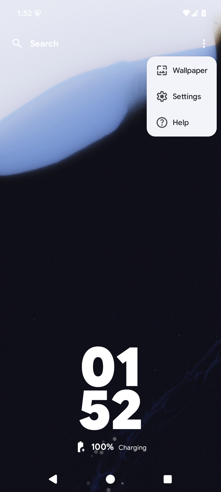
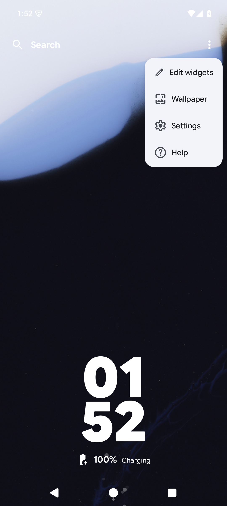

# Kvaesitso #1504: matched original / Morphe prototype evidence

Captured on 2026-10-24 on a disposable rooted AOSP Android 15 / API 35 ARM64 emulator, using synthetic local widget data. PNGs are native screenshots without image editing.

## Inputs and publication scope

- [Official Kvaesitso v1.41.0 release](https://github.com/MM2-0/Kvaesitso/releases/tag/v1.41.0), asset `de.mm20.launcher2.release-v1.41.0.apk`.
- Package `de.mm20.launcher2.release`, version 1.41.0.
- Original APK SHA-256: `55e4a287f1198be22f040c2ad1443f5861b58b1d1394d7377221f1ad4448b810`.
- Official certificate SHA-256: `bf65bbd617997397800d02e0ac2e45cee153151518545c23ef66b3cb2cfdf7bc`.
- The before APK retains the unchanged official code/resources and is re-signed with a disposable test key. The Morphe-patched after APK uses the same test key. This permits a same-key update retention check; it does not demonstrate updating an upstream-signed installation with a different certificate.
- The images show an APK-patch prototype, **not the separately tested native source fix**. [Penguin Patches](https://github.com/pengusto/penguin-patches) is the independent Morphe-compatible patch collection. Kvaesitso patch code/bundle and APKs remain unpublished. This directory publishes evidence only.

## Matched comparison

Both variants use the same widget rows, settings, separate widget-page layout and disabled Edit button. The runner verifies the actual preference through the app's settings UI, then opens the search bar's own overflow menu.

| Before: Edit button hidden, menu action missing | After: Edit button stays hidden, menu action restored |
| --- | --- |
|  |  |

The after action opens the existing, usable [widget editor](editor.png), including its Add widget action. The real UI regression exits using Done and Back, reopens editing, and verifies that the hidden-button preference remains disabled. No fake editor or replacement screenshot UI is used.

Every stored Widget column/row and setting is compared immediately before and after the same-key update. Entering and exiting the editor retains those widget rows and settings; initial fixture settings are restored afterwards. The current capture run does not add, remove or reorder widgets. Those operations were covered by the earlier separate local acceptance suite.

[verification.json](verification.json) contains the APK/certificate and image hashes plus the result of the matched UI and retention checks. Raw UI XML, logs, settings and Room databases stay local and are not published.

## Limits

Only the original official 1.41.0 APK on the AOSP Android 15 / API 35 ARM64 emulator is established here. Physical/OEM devices, other Android/app versions, third-party widget providers and rotation/process death during editing are not proven. The separate native implementation needs its own upstream review. No native PR, Kvaesitso patch release, APK or signing key is published by this evidence update.

Kvaesitso and the reused editor/navigation UI are by MM2-0 and contributors, licensed GPL-3.0-or-later. This comparison addresses [issue #1504](https://github.com/MM2-0/Kvaesitso/issues/1504).
