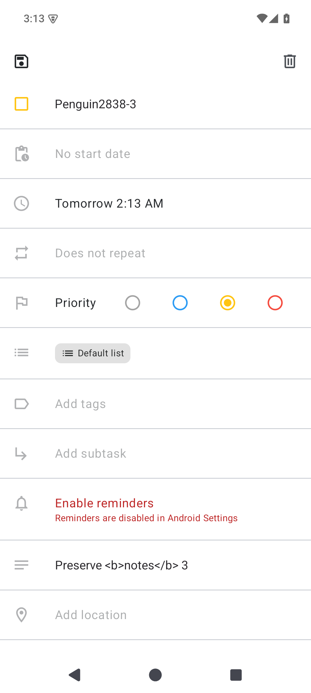
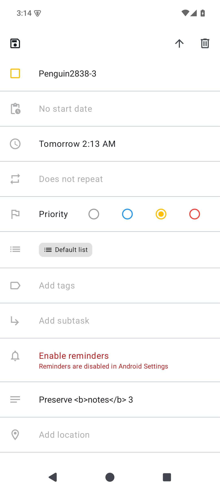

# Tasks.org #2838: explicit parent navigation on Android

Captured on 2026-10-24 on a disposable rooted AOSP Android 15 / API 35 ARM64 emulator. All tasks are synthetic and local, with no sync accounts. PNGs are raw native emulator captures, without image editing.

## Inputs and publication scope

- Official [Tasks.org 15.13 release](https://github.com/tasks/tasks/releases/tag/15.13), project-hosted asset `tasks-fdroid-15.13.apk`, package `org.tasks`, version code 151306. This is the project's GitHub F-Droid variant; a separately signed fdroid.org build is untested.
- Original APK SHA-256: `7df9620d84a824a834598843f954943009012d75fbb16572e5ec88a414a576b9`.
- Official signer SHA-256: `5efd4ed0baccbfd3c117987ebeac34cf601d0831ec4bb3e597467742130569fd`.
- Before: unchanged official APK code/resources, re-signed with a disposable test key.
- After: the same official original APK with the local **Navigate to the parent task** Morphe patch, signed with the same disposable test key.
- These images demonstrate the locally Morphe-patched APK. A native Android source PR would be a separate implementation, subject to maintainer greenlight.
- Only reviewed images and curated evidence documents are published here. The Tasks patch code/bundle, APKs, signing keys, databases, preferences and full logs remain unpublished. The current public Penguin Patches release does not contain this Tasks patch.

## Matched comparison

The same synthetic child task `Penguin2838-3`, due date, notes and list are visible in both variants. The original has no parent action. The patched editor adds an up-arrow to open the persisted immediate parent. Back retains the native route to the selected list/filter.

| Before: official original APK payload | After: local Morphe patch |
| --- | --- |
|  |  |

[Parent editor](parent.png) shows the actual destination `Penguin2838-2`. [Draft confirmation](draft-dialog.png) offers Save, Discard and Cancel after editing the child. Save uses the app's existing transaction; Discard prevents native disposal auto-save; Cancel keeps the draft. The patch keeps the current search/Today/list filter, including when the parent lies outside it. Missing/deleted destinations retain the editor and draft; a destination is rechecked after the confirmation dialog.

## Verification and limits

The local repeatable runner verifies original APK checksum/identity/certificate, unchanged baseline code/resources and matching disposable test signatures. Every row in both native databases, shared preferences and datastore files survives the same-key APK update unchanged. This is a test update between re-signed fixtures; updating an upstream-signed installation with a different key is not demonstrated.

The original reproduces #2838 (22 baseline assertions). The patched APK passes 178 native integration assertions, including real Compose clicks; parent/hierarchy/sibling navigation; search/Today filters; native save/discard/cancel; notes/date/hierarchy and other-task row retention; unavailable parents, including deletion while confirmation is open; read-only/completed tasks; corrupt parent metadata; activity recreation with a draft; and native Back. Four negative cases reject unsupported package/version, repeated patching and modified bytecode. Build/lint, actual-APK linkage and bundle isolation pass. These are emulator integration tests of the Morphe prototype; they are not native source-fix tests.

Physical/OEM devices, real CalDAV/Google sync, concurrent remote edits and alternate APK distributions/versions remain unverified. Activity recreation was tested; the screenshots do not establish process-death draft recovery or sync behavior.

[verification.json](verification.json) records the APK/signature and screenshot hashes and curated results. It contains no private signing material or full logs.

Tasks.org and its native UI are by Alex Baker and contributors, GPL-3.0. [Penguin Patches](https://github.com/pengusto/penguin-patches) is an independent GPL-3.0 Morphe-compatible patch collection. This evidence addresses [Tasks.org #2838](https://github.com/tasks/tasks/issues/2838).
