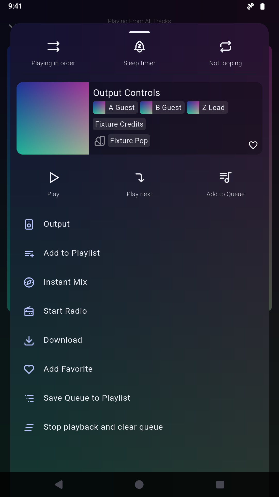

# Finamp output access and banner contrast — Android acceptance

The two focused source contributions are [PR1836 / #1355](https://github.com/finamp-app/finamp/pull/1836)
and [PR1837 / #1756](https://github.com/finamp-app/finamp/pull/1837), targeting
`redesign` at `b72ba46a45eb45836516f23e3df989c89c693c88`.
The APK backports separately target the official 1.0.1 release. Source regressions
exercise the actual production widgets; these images are installed APK captures.

## Matched player-menu pair

| Before: original native code | After: Manager output patch alone |
| --- | --- |
|  |  |

Both use the synthetic Output Controls track paused at 28 seconds, Dark theme,
English, hidden player bottom actions, disabled gestures, 1080×1920/density320
and demo clock09:41. No keyboard or unrelated dialog obstructs either view.
The additional [opened output sheet](player-output-opened.png) verifies that
Output reaches the existing volume/device controls and dismisses back to Player.

The original-code baseline is re-signed with the disposable fixture key to allow
same-key updates. Its native code and engine retain the official release bytes;
it is not a source-rebuilt baseline. The patched image uses the real Manager
export. Original-code removal and same-key reapply were also exercised before
capturing the final matched pair, retaining login, theme and paused queue.

| Identity | SHA-256 / source |
| --- | --- |
| Official input APK | `0fc61e5cb80d37b10a735851c2217cbc855b3f1a04bde577187658531ffef581` |
| Same-key baseline APK | `a43d9464b2bc778b506575ab7a3a84c4368a94f6f51a9dff7902d2b7828a67a8` |
| Baseline native | `83de04b43bfcad7f1ae9aa69b433044f409d89957cccdc9deb6b6b0e85789607` |
| Baseline source | `65c1a78b1d04dd8525825ecdf2cf39c7442b51e9` |
| Manager mask32 APK | `7fe6f940aec684b2d0eddbc6b5fc105a4769c889cdbdd01db28eac782d2a4355` |
| Mask32 native | `3b3971fd02d8825a051189b74b84791841c2cabdc7bcddca0bde5a302396e3ce` |
| Mask32 source | `98f45b17686b1887849482d2fd9d0c20fc2477e3` |
| Engine (unchanged) | `d70bbedc2b157630f90123a32ca894a6fa1816ec10cda9f335bada0692b376ee` |

Raw PNGs, XML and capture JSON are preserved alongside the acceptance receipts.
[checksums.json](checksums.json) hashes the evidence files. No images were edited.
No APK, signing key, fixture credentials or fixture-control token is committed.

## Six-patch checkpoint for #1355

Official Manager2.2.0 / Patcher2.0.1, Android15/API35 ARM64, disposable
`penguin` / `emulator-5580`. The local six-patch candidate was
187,091,703 bytes, SHA-256
`f98e5b394b6f1d8119d8f49205b65daf8e4ad8f0f55d01543c332869ffedbdbd`.
Its cached bytes and original-APK cache were independently checked through
read-only inspection. The older Penguin remote source was disabled.

- All six rows initially off, unrelated universal patches0/5.
- [Only Output selected](checkpoint-manager-output-selected.png), actual JVM
  [apply success](checkpoint-manager-success.png), UI Save/export.
- The exported APK passes exact native output, every retained entry, ARM64-only,
  fixture signature, uncompressed native entries and16KiB loading alignment.
- Manager Install → Android UPDATE succeeded; the installed APK hash matches
  the export. No data clear or key/database edit was performed.

The first runner pull expected the historical `finamp-manager-test` subfolder,
but Android Save had reset to Downloads after source search. The fresh successful
Manager export was recovered from the observed Downloads path and independently
verified. The receipt records this correction; subsequent runs take an explicit
`--export-directory`. This was a runner path assumption, not a patcher failure.

The complete seven-patch candidate/release results and banner pair are recorded
when their acceptance finishes. This checkpoint alone is not the final suite.

## Reproduction and limits

Follow [README-ui-fixes.md](../../README-ui-fixes.md) with fresh output paths.
The complete seven-fix source passes78 tests; #1355 has four focused tests and
#1756 eight. Source tests and APK/Manager tests establish different boundaries.
Emulator/synthetic-server checks do not establish physical/OEM-device coverage
or live Jellyfin-server behavior. Native file size is not a RAM benchmark.
