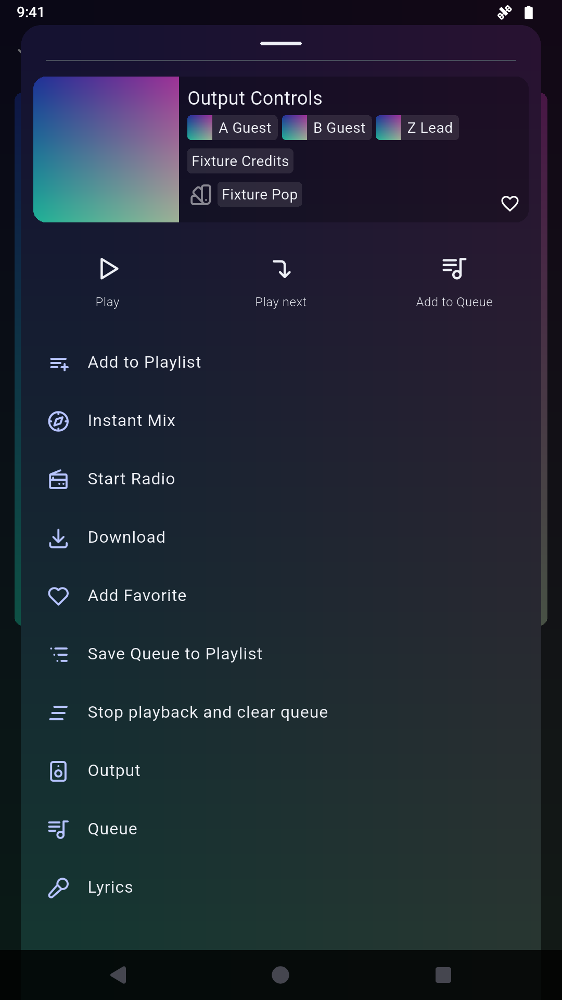

# Reviewed player menu — 2026-10-30

The existing optional **Keep player output controls accessible** patch now
backports final upstream PR #1836, commit
`0092a0593a9d69dfc461834d0e4e6c580d112379`, to the pinned original Finamp1.0.1
universal APK. Native feature source: `8b4adc590944ddd177d3fdc42bf47518b3eb0c9d`.

## Raw installed-APK comparison

| Original native code | Manager Player-only export |
| :---: | :---: |
|  |  |

Both raw, unedited ADB PNGs use the same synthetic track paused at00:17, Dark
theme, hidden bottom actions, disabled gestures, profile0, 1080×1920/density320
and demo clock09:41. XML and individual PNG hashes accompany both images. The
original-code baseline keeps every retained official APK entry and uses the same
disposable signer for update testing. The after APK was patched, exported,
installed through Manager Install → Android UPDATE and opened through Manager.
Its installed APK hash matches the export. No app data was cleared.

The original APK is SHA256
`0fc61e5cb80d37b10a735851c2217cbc855b3f1a04bde577187658531ffef581`.
The integrated local candidate is SHA256
`6d49265ab19ba24d9790533abd43d193bbaac00120dea76d2793856a1e62b9cc`.
It retains the current dev Mihon/Komikku additions and all seven prior MPEs.

## Verified scope

- All64 affected native compositions rebuilt after their full source tests:
  4,096 overlapping executions, 101 tests in mask127. The same27 focused
  regressions yield5 pass/22 fail before and27 pass after. The other63 nonempty
  payloads remain byte-identical. Both published source diffs recreate the exact
  source tree; all128 public source refs match the matrix.
- All127 native replays and all127 real Morphe Desktop1.19.1/Patcher2.0.1
  applications pass; only ARM64 libapp.so changes in retained APK contents.
  Four unsupported-input cases fail through a selected patch without an output.
- Manager2.2.0/Patcher2.0.1 Player-only JVM export has the expected native hash,
  verified fixture signer, uncompressed native entries and16KiB alignment.
- Actual Output, Queue and Lyrics routes open and return. The Lyrics menu has
  Output and Queue, with no recursive Lyrics route. Five actual disabled-gesture
  swipes retain route and track. Player artwork secondary mouse input opens the
  same three-action menu; its coordinates come from fresh accessibility bounds.

The local complete Manager suite, data-retention chain and released remote-source
acceptance are recorded after completion below. Desktop runs are not Manager UI
runs. This evidence covers a synthetic Android15/API35 ARM64 emulator; physical
phones, OEM behavior, other versions, real libraries and timing/RAM claims are
outside this record. No patched APK, signing key or private app-data archive is
committed here.
